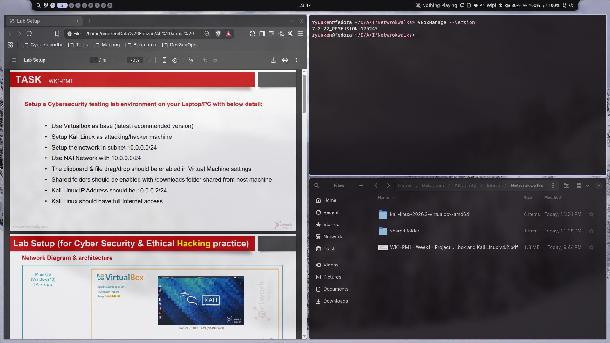
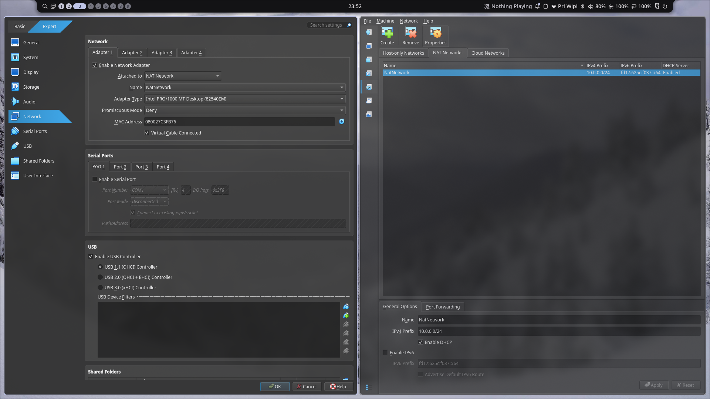
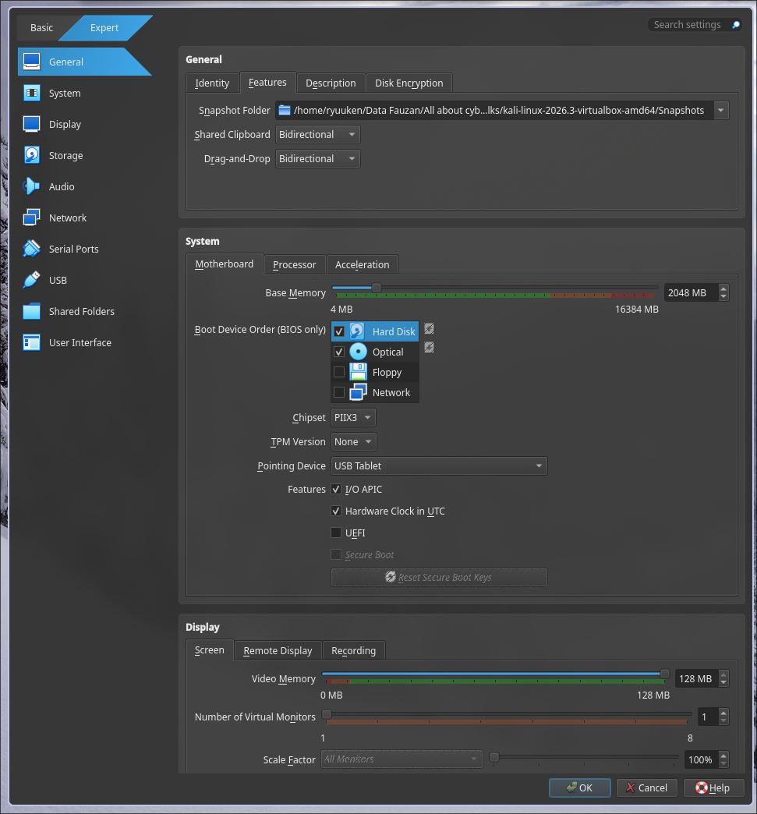
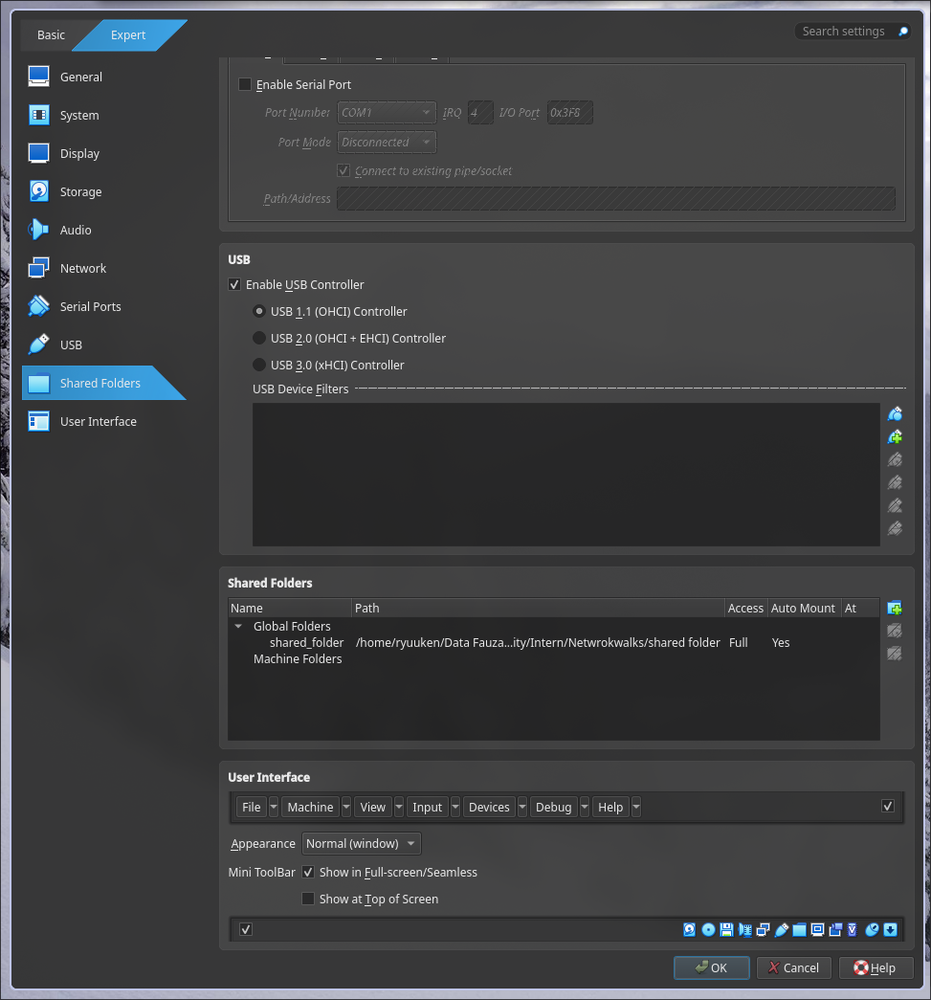
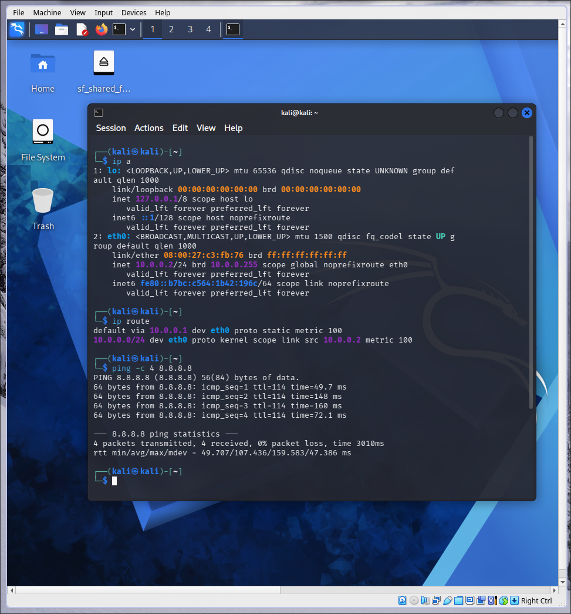
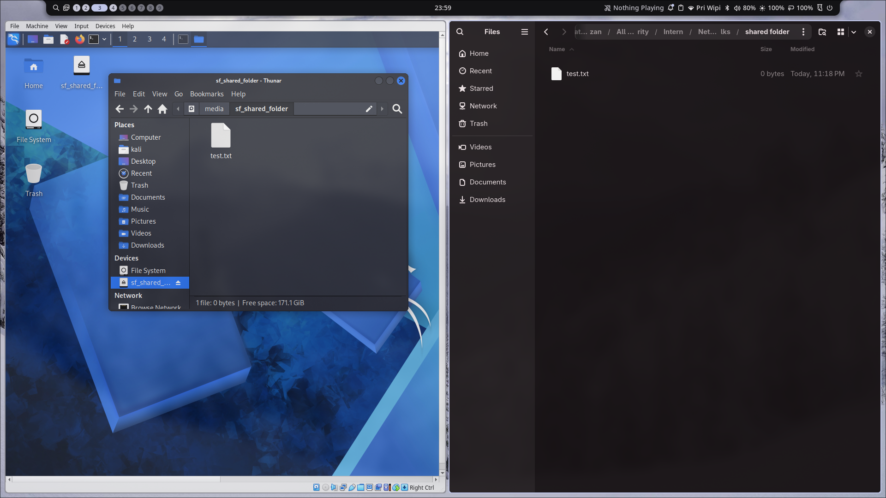
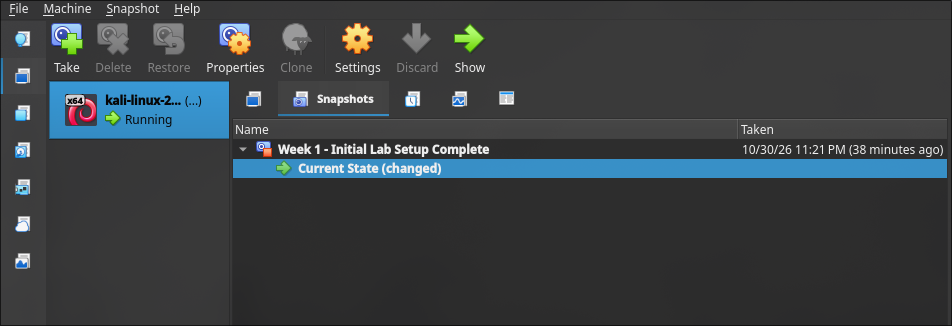

  Cybersecurity Lab Environment Setup (WK1-PM1) body { font-family: -apple-system, BlinkMacSystemFont, "Segoe UI", Roboto, Helvetica, Arial, sans-serif; line-height: 1.6; color: #24292e; max-width: 850px; margin: 0 auto; padding: 40px 20px; background-color: #ffffff; } h1, h2, h3 { border-bottom: 1px solid #eaecef; padding-bottom: 0.3em; color: #24292e; } h1 { font-size: 2em; margin-bottom: 10px; } h2 { font-size: 1.5em; margin-top: 30px; } h3 { font-size: 1.25em; margin-top: 24px; border-bottom: none; } p { margin-bottom: 16px; } code { background-color: rgba(27,31,35,.05); border-radius: 3px; font-size: 85%; padding: .2em .4em; font-family: SFMono-Regular, Consolas, "Liberation Mono", Menlo, monospace; color: #d73a49; } pre { background-color: #f6f8fa; border-radius: 6px; font-size: 85%; line-height: 1.45; overflow: auto; padding: 16px; border: 1px solid #e1e4e8; } pre code { background-color: transparent; padding: 0; color: #24292e; font-size: 100%; } ul, ol { padding-left: 2em; margin-bottom: 16px; } li { margin-bottom: 8px; } img { max-width: 100%; height: auto; border: 1px solid #d0d7de; border-radius: 6px; box-shadow: 0 2px 5px rgba(0,0,0,0.05); margin: 15px 0 25px 0; display: block; } hr { border: 0; border-top: 1px solid #eaecef; margin: 30px 0; } .meta { background-color: #f6f8fa; padding: 15px; border-radius: 6px; border-left: 4px solid #0366d6; margin-bottom: 20px; } .meta li { margin-bottom: 4px; }

🔐 Cybersecurity Lab Environment Setup (WK1-PM1)
================================================

**Building an isolated virtual lab for penetration testing and ethical hacking practice**

*   **Student:** Fauzan (Batch B084D)
*   **Host OS:** Fedora Workstation (Linux)
*   **Hypervisor:** VirtualBox 7.2.22 (RPM Fusion)
*   **Attacker VM:** Kali Linux (official VirtualBox image)

* * *

📌 Project Overview
-------------------

This project documents the setup of a **virtual cybersecurity and penetration-testing laboratory** using VirtualBox and Kali Linux on a Fedora Workstation host, following the Networkwalks Academy Week 1 – Project Module 1 requirements:

*   VirtualBox as the virtualization base (latest recommended version).
*   Kali Linux as the attacking/hacker machine.
*   Lab network on subnet `10.0.0.0/24` using a custom NATNetwork.
*   Shared clipboard & file drag/drop enabled (Bidirectional).
*   Shared folder enabled (host `Downloads` folder shared to the VM).
*   Kali Linux static IP: `10.0.0.2/24`.
*   Full Internet access on the Kali VM.
*   VM snapshot taken as a clean rollback point.

🎯 Objectives
-------------

*   Install and configure VirtualBox on a Linux (Fedora) host.
*   Import Kali Linux as the attacker virtual machine.
*   Create an isolated NAT Network (`10.0.0.0/24`) for the lab.
*   Configure static IP, gateway, and DNS on the Kali VM.
*   Verify Internet connectivity and DNS resolution.
*   Enable clipboard, drag & drop, and shared folders between host and VM.
*   Take a clean VM snapshot for recovery.

* * *

🪜 Lab Setup Procedure
----------------------

### Step 1. Install 7-Zip (host)

7-Zip is used to extract the Kali Linux VM archive (`.7z`).

    sudo dnf install 7zip

### Step 2. Install VirtualBox (Fedora host)

VirtualBox was installed from RPM Fusion together with its kernel module:

    sudo dnf install VirtualBox akmod-VirtualBox
    sudo dnf install @development-tools kernel-devel kernel-headers dkms
    sudo akmods --force
    sudo systemctl restart vboxdrv.service
    sudo usermod -a -G vboxusers $USER   # then log out / log back in

### Step 3. Create the NAT Network

VirtualBox → Tools → Network Manager → NAT Networks → Create.

*   **Network Name:** NatNetwork
*   **IPv4 Prefix:** 10.0.0.0/24
*   **DHCP:** Enabled

A NAT Network allows all lab VMs to communicate with each other while keeping outbound Internet access.

### Step 4. Import Kali Linux & VM Settings

Kali Linux VirtualBox image downloaded from kali.org/get-kali, extracted with 7-Zip, and imported into VirtualBox.

*   **Adapter 1** → Attached to: NAT Network (NatNetwork)
*   **General → Advanced:** Shared Clipboard & Drag'n'Drop = Bidirectional
*   **Shared Folders:** host `Downloads` folder, Auto-mount enabled.

  

### Step 5. Configure Kali Linux Network (10.0.0.2/24)

    sudo nmcli connection modify "Wired connection 1" ipv4.addresses 10.0.0.2/24
    sudo nmcli connection modify "Wired connection 1" ipv4.gateway 10.0.0.1
    sudo nmcli connection modify "Wired connection 1" ipv4.dns "8.8.8.8 1.1.1.1"
    sudo nmcli connection modify "Wired connection 1" ipv4.method manual
    sudo nmcli connection modify "Wired connection 1" ipv4.dad-timeout 0
    sudo nmcli connection down "Wired connection 1"
    sudo nmcli connection up "Wired connection 1"

Verification: `ip a` shows `10.0.0.2/24`, `ip route` shows default via `10.0.0.1`, and `ping google.com` succeeds with 0% packet loss.

Shared folder access inside Kali: `sudo usermod -aG vboxsf kali` then reboot.

 

### Step 6. Take a VM Snapshot

Snapshot name: "Week 1 - Initial Lab Setup Complete"

* * *

🧰 Troubleshooting (Problems Faced & Solutions on Fedora)
---------------------------------------------------------

1.  **`sudo dnf install @virtualbox` → "No match for argument: virtualbox" (Fedora 44).**
    *   _Solution:_ On Fedora, the package name is just `VirtualBox`. I enabled RPM Fusion and installed `sudo dnf install VirtualBox akmod-VirtualBox`. The `vboxusers` group only exists after installation, so I ran `usermod` afterwards.
2.  **"WARNING: The vboxdrv kernel module is not loaded".**
    *   _Solution:_ Ran `sudo akmods --force` to build the module for my current kernel, then `sudo systemctl restart vboxdrv.service`.
3.  **Kali VM had no Internet ("Destination Host Unreachable" / DNS failure) on VirtualBox 7.**
    *   _Solution:_ Ensured Adapter 1 is attached to "NAT Network" (not plain "NAT") and enabled the DHCP server on the NATNetwork in VirtualBox settings. Then applied the course fix: `sudo nmcli connection modify "Wired connection 1" ipv4.dad-timeout 0` + connection down/up, and power-cycled the VM.
4.  **VirtualBox 7 shared-folder dialog has no "Make Permanent" checkbox.**
    *   _Solution:_ In VBox 7 it is replaced by "Make Global"; enabling "Auto-mount" is enough to keep the folder mounted on every boot.

* * *

✅ Result
--------

A fully working, isolated cybersecurity lab ready for future modules!
